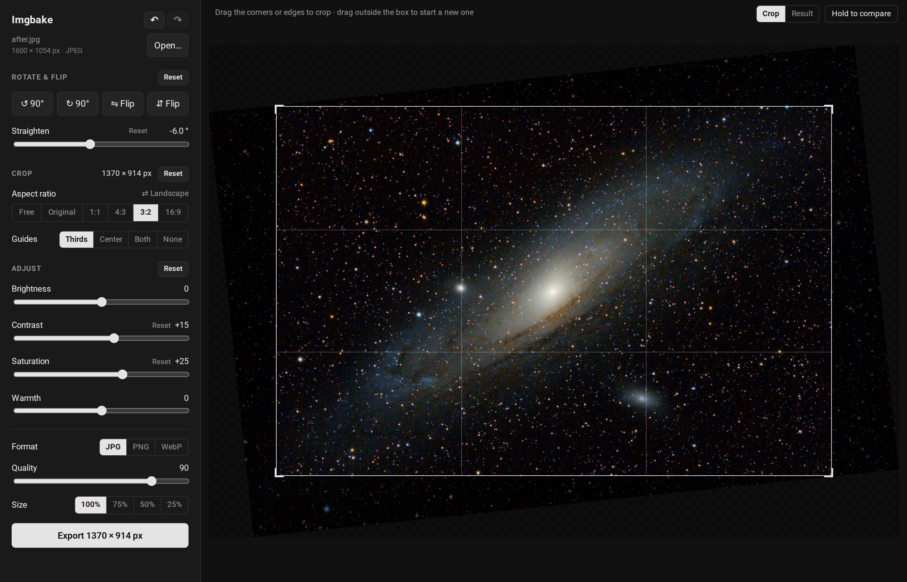

# Imgbake

Imgbake is a simple photo editor for the quick fixes: rotate, flip, straighten, crop, adjust brightness, contrast, saturation and warmth, then export a resized copy as JPEG, PNG or WebP. It opens in its own window, previews every change live, and never touches your original.



## Download

Grab the file for your computer from the [latest release](../../releases/latest).

| System                | File                    | To start                                                          |
| --------------------- | ----------------------- | ----------------------------------------------------------------- |
| Windows               | `Imgbake-Windows.exe`   | Double-click it.                                                  |
| macOS (Apple Silicon) | `Imgbake-macOS.zip`     | Unzip, move `Imgbake.app` to Applications, double-click it.       |
| Linux                 | `Imgbake-Linux.tar.gz`  | Extract, open the `Imgbake` folder, double-click `Imgbake` in it. |

### The first time you open it

Imgbake isn't signed with a paid developer certificate, so your system will warn you once:

- **Windows:** "Windows protected your PC". Click **More info**, then **Run anyway**.
- **macOS:** "Imgbake can't be opened" or "Apple could not verify…". Click **Done**, open **System Settings → Privacy & Security**, scroll down and click **Open Anyway** next to Imgbake. (On macOS 14 and older you can instead right-click the app and choose **Open**.)
- **Linux:** if double-clicking does nothing, right-click `Imgbake` → **Properties** → allow it to run as a program.

## Using it

1. Click **Open image…** (or drag a photo onto the window). JPEG, PNG, WebP, TIFF, BMP and GIF all work. Phone photos come in the right way up.
2. **Rotate & flip:** turn by 90° or mirror the picture. **Straighten** tilts it a little to level a horizon. The crop shrinks to leave out the empty corners this makes.
3. **Crop:** drag the corners or edges of the box, drag inside it to move it, or drag outside it to draw a new one. Pick an aspect ratio (1:1, 4:3, 3:2, 16:9, or the photo's own) to lock its shape, and **⇄** to switch between portrait and landscape.
4. **Adjust** brightness, contrast, saturation and warmth. Every slider starts at 0. Click **Reset** next to one (or double-click the slider) to put it back.
5. Check it with **Result** (the picture as it will be saved) or press and hold **Hold to compare** to see the original.
6. Pick a **Format**, a **Size** and click **Export**. Imgbake saves `<name>_edited.jpg` (or `.png`, `.webp`) next to your original, at full resolution. Exporting again never overwrites: the next one gets `_2`, and so on. **Show in folder** takes you to it.

Exports keep the photo's colour profile. Untick **Keep photo info** to leave out the date, camera settings and GPS location, for example before posting a photo online. JPEG has no transparency, so see-through areas come out white; PNG and WebP keep them.

| Shortcut                 | Does                               |
| ------------------------ | ---------------------------------- |
| Ctrl+O (⌘O)              | Open an image                      |
| Ctrl+S (⌘S)              | Export                             |
| Ctrl+Z / Ctrl+Shift+Z    | Undo / redo (⌘ on a Mac)           |
| R / Shift+R              | Rotate 90° clockwise / anticlockwise |
| Hold \\                  | Compare with the original          |

## Running from source

If you have Python 3.9+:

```
python3 imgbake.py
python3 imgbake.py photo.jpg      # open with that photo
```

If any packages are missing it offers to install them (Pillow and pywebview, plus Qt on Linux if your system has no GTK WebKit). On Linux systems that don't allow that, it sets up a private virtual environment in `.venv` for you. If no window can be made, it opens in your web browser instead. `--browser` does that on purpose.

### Tests

```
python3 test_imgbake.py
```

They use small generated images and take a second or two.

## Building the apps

GitHub Actions builds all three apps (see [.github/workflows/release.yml](.github/workflows/release.yml)). Push a version tag to publish a release with them attached:

```
git tag v1.0.0
git push origin v1.0.0
```

To build one locally: `pip install -r requirements.txt pyinstaller`, then `pyinstaller imgbake.spec`. The result goes in `dist/`.

The window is a web page drawn by the system's own browser engine (Edge WebView2 on Windows, WebKit on macOS), so those apps are small. Linux has no engine every distribution shares, so the Linux app brings Qt's, which makes it the big download.
